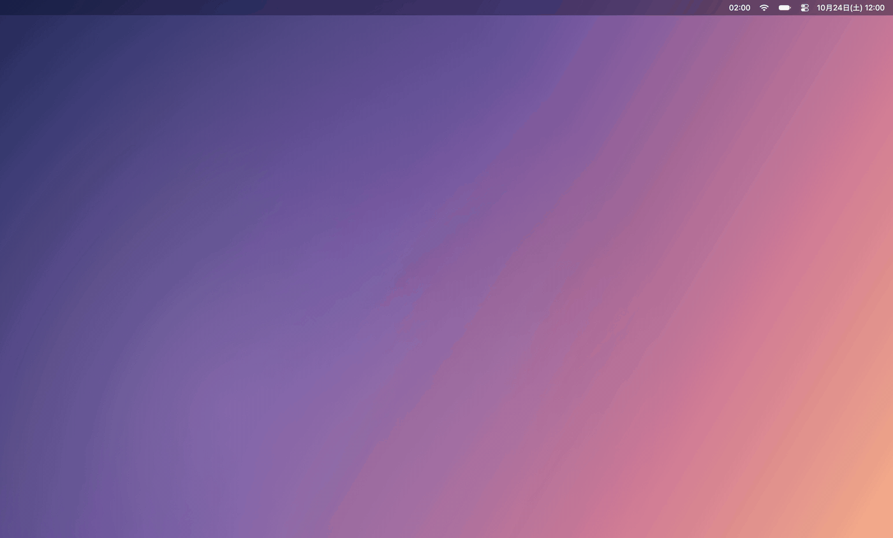
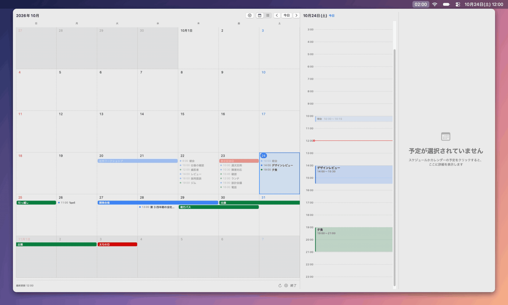
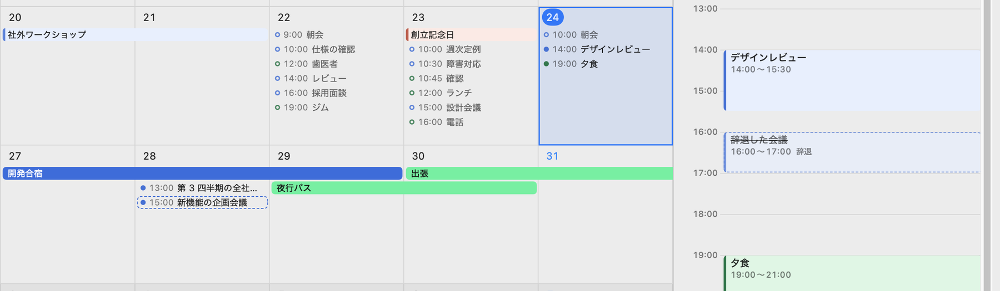
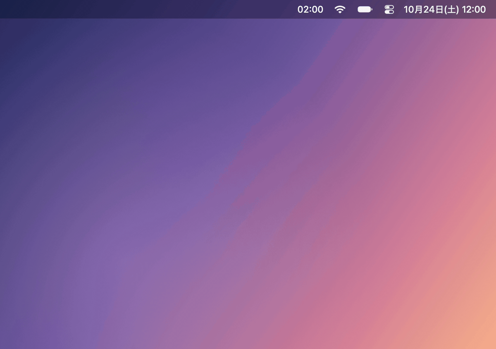
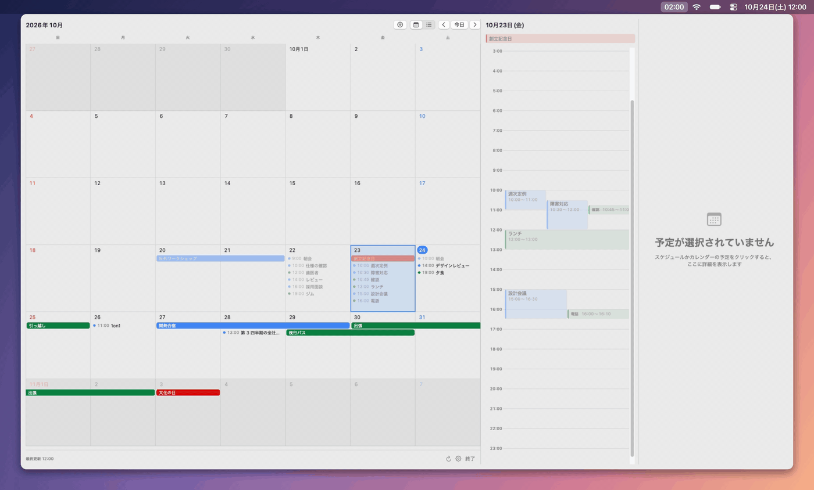
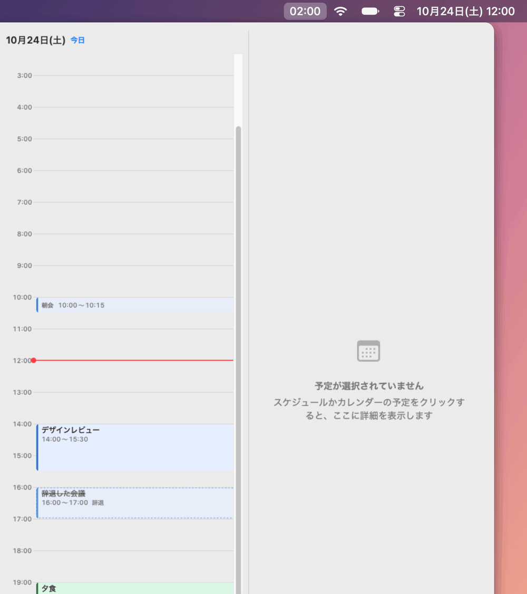
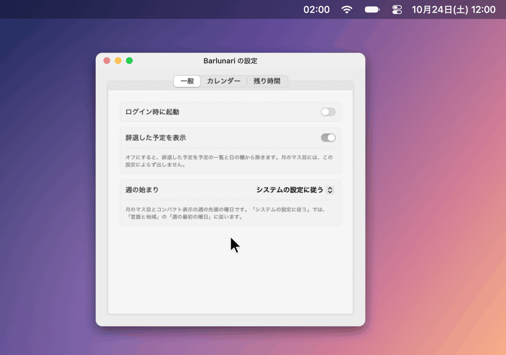
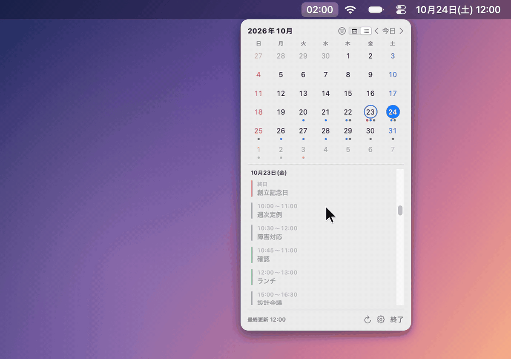
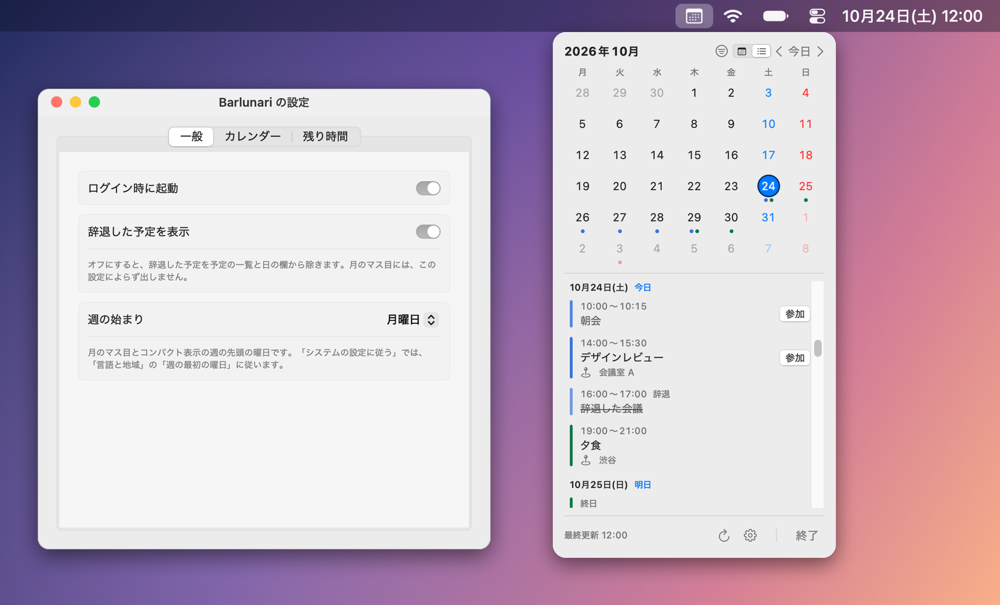

# Barlunari

メニューバーから、Google カレンダーなどの予定をすぐに確認できる macOS アプリです。予定は Mac のカレンダーから同期されます。macOS の「インターネットアカウント」に追加したアカウントのカレンダーを、Mac の「カレンダー」アプリと同じデータから EventKit で読み込み、まとめて表示します。アプリ自体にサインインはなく、認証情報も持ちません。



画像はすべて、架空のサンプルデータで作成しています。

## 特長

### 月表示

予定をマス目の中に並べた、大きな 1 枚のカレンダーです。日を押すと、右の欄にその日のスケジュールが時刻順に出ます。予定を押すと、さらに右の列に、場所・会議の URL・参加者・メモが出ます。スケジュールは出したままなので、同じ日の予定を続けて確認できます。

招待された予定の詳細には「承諾」「未定」「辞退」のボタンが出て、押すと自分の出欠を変更します。選んでいる出欠のボタンは、色だけでなく塗りの記号と太い文字でも区別できます。繰り返しの予定は、表示している回だけに回答します。辞退すると、詳細は開いたまま残るので、押し間違いは「承諾」などで取り消せます。自分が主催者の予定と、出欠のない予定にはボタンが出ません。回答を保存できなかったときは、理由と「カレンダーで開く」ボタンが出て、標準のカレンダーアプリで予定を開いて回答できます。



### 未回答と辞退した予定

未回答の予定は、予定一覧、日の欄、月のマス目で、予定の色の破線の枠で囲みます。辞退した予定は、予定一覧と日の欄で、取り消し線を引いて薄く表示します。日の欄では、辞退した予定を薄い破線の枠でも囲みます。予定一覧と日の欄には「未回答」「辞退」の文字も出ます。

月のマス目には、辞退した予定を出しません。コンパクト表示のマス目の色の点にも、辞退した予定を数えません。設定の「一般」のタブで「辞退した予定を表示」をオフにすると、辞退した予定を予定一覧と日の欄から除きます。月のマス目には、この設定によらず出しません。既定はオンです。



### 途切れずに流れるマス目

マス目は週の行が連続して流れ、スクロールすると表示月が切り替わります。月の境目で止まらないので、月をまたぐ予定も続けて確認できます。


### コンパクト表示

幅の狭い月のカレンダーと、日ごとの予定一覧です。予定一覧は選択日から始まり、スクロールすると日が進みます。



### 表示するカレンダーの切り替え

見出しのボタンから、表示するカレンダーをアカウントごとに選べます。チェックを切り替えると、その場で表示に反映されます。



### メニューバーの残り時間

メニューバーの項目には、次の予定までの残り時間を、`01:25` のように時間と分で出します。対象は、これから 24 時間未満で始まる予定です。時刻付きの予定は初めから対象で、終日の予定は初めは対象外です。終日の予定を対象にすると、その日の 0:00 までの残り時間を出します。対象の予定がなければ、カレンダーのアイコンを出します。

予定ごとには、予定の詳細の「メニューバーの残り時間に含める」のチェックボックスで、残り時間に含めるかを選びます。繰り返しの予定は、回ごとに選びます。辞退した予定は、チェックがオンでも数えません。



カレンダーごとには、設定の「残り時間」のタブで、含めないカレンダーのチェックを外します。含めないカレンダーの予定は、残り時間に含めません。予定ごとの選択は、カレンダーごとの設定より優先され、カレンダーの設定を変えても消えません。



予定ごとの選択が、カレンダーごとの設定を含めた初めの設定と違う予定には、予定一覧、月のマス目、日の欄に時計の記号が付きます。時計の右下に赤い×が付いた記号は、対象から外した時刻付きの予定です。時計の右下に青いチェックが付いた記号は、初めは対象外の予定を対象にしたものです。終日の予定と、含めないカレンダーの予定が当たります。初めの設定のままの予定には付きません。設定の「残り時間」のタブでカレンダーのチェックを外しただけでは、そのカレンダーの予定に記号は付きません。

### 設定

パネルの右下の歯車のボタンで、設定のウインドウを開きます。「一般」のタブでは、ログイン時に起動するかと、辞退した予定を表示するかと、週の始まりの曜日を選びます。週の始まりは、「システムの設定に従う」と日曜日から土曜日のどれかから選ぶ項目で、既定は「システムの設定に従う」です。曜日を選ぶと、月のマス目とコンパクト表示の曜日の見出しとマス目がその曜日から始まり、以後は「言語と地域」の「週の最初の曜日」を変えても影響を受けません。「システムの設定に従う」に戻すと、再びシステムの設定に従います。「カレンダー」のタブでは、表示するカレンダーをアカウントごとにオンとオフで切り替えます。「残り時間」のタブでは、メニューバーの残り時間に含めるカレンダーを、アカウントごとにチェックボックスで選びます。非表示のカレンダーは予定を取得しないので、残り時間に含まれず、チェックボックスは操作できません。





## 必要環境

- macOS 15 以降
- Swift 6.2 以降のツールチェーン。Xcode 26 以降に含まれます

## インストール

```sh
git clone https://github.com/derushio/barlunari
cd barlunari
scripts/install.sh                 # Barlunari.app を組み立てて /Applications に入れ、起動します
```

`scripts/install.sh` は、動いている Barlunari を終了させてから `/Applications/Barlunari.app` を置き換え、前面に出さずに起動します。新しい版にするときは、`git pull` してからもう一度実行します。組み立てに使った `build/Barlunari.app` は削除します。同じアプリが 2 か所にあると、macOS が別のほうを開いたり、別のほうに許可を付けたりするためです。設定と許可は引き継がれます。ログイン時に起動する設定にしている場合は、起動したときに `/Applications/Barlunari.app` を登録し直します。

Claude Code を使っている場合は、次のように頼むと、クローンから起動までを Claude Code が実行します。

```text
https://github.com/derushio/barlunari をクローンして、scripts/install.sh で Barlunari.app を /Applications に入れて起動して
```

`scripts/install.sh` が使う `scripts/bundle.sh` は、`Barlunari.app` を自己署名の証明書で署名します。証明書は、初めて実行したときに `~/Library/Application Support/Barlunari Signing/` の専用のキーチェーンに作られ、以降は同じ証明書で署名します。ログインキーチェーンとキーチェーンの検索リストは変更しません。毎回同じ証明書で署名するので、ビルドし直してもカレンダーへのアクセスの許可は残ります。このディレクトリを削除すると証明書が作り直されるので、下の手順でもう一度許可します。

## 予定を表示する準備

Barlunari は macOS が同期したカレンダーを読むので、Google 側の設定は要りません。

### アカウントを追加する

1. macOS の「システム設定」を開き、「インターネットアカウント」を選びます
2. 「アカウントを追加」を押し、「Google」を選んで、画面の案内に従ってサインインします。複数のアカウントを追加できます
3. 追加したアカウントの「カレンダー」をオンにします

iCloud やその他の CalDAV のアカウントも、同じ手順で追加すると表示されます。アカウントの追加と削除は、Barlunari ではなく「インターネットアカウント」で行います。Barlunari の設定画面にも「「インターネットアカウント」を開く」ボタンがあります。

### カレンダーへのアクセスを許可する

1. メニューバーのカレンダーのアイコンをクリックします。アイコンを押したディスプレイのメニューバーの下に、パネルが開きます
2. 「カレンダーへのアクセスを許可」を押します
3. macOS のダイアログで、フルアクセスを許可します

許可を求めるのは、このボタンを押したときだけです。起動時には求めません。許可を拒否したときは、パネルに「システム設定を開く」が出ます。「プライバシーとセキュリティ」の「カレンダー」で、Barlunari にフルアクセスを許可します。

## 使い方

| 操作 | 方法 |
| --- | --- |
| パネルを開く | メニューバーの項目をクリック。次の予定までの残り時間か、カレンダーのアイコンが出ています |
| パネルを閉じる | パネルの外をクリック、Esc キー、メニューバーの項目をもう一度クリック |
| 月表示に切り替える | パネルの上の切り替え、または ⌘1 |
| コンパクト表示に切り替える | パネルの上の切り替え、または ⌘2 |
| 詳細や一覧を閉じる | Esc キー |
| 設定を開く | パネルの右下の歯車のボタン |
| 予定を残り時間に含めるかを選ぶ | 予定の詳細の「メニューバーの残り時間に含める」のチェックボックス |

- 選んだ表示モードは、次に開いたときも使われます
- 月表示のパネルは、開いたディスプレイの大きさに合わせて開きます。画面が狭いときは詳細の列を出さず、スケジュールの欄に詳細を開きます
- 入りきらない日の「他 N 件」を押すと、その日が選ばれ、全件がスケジュールの欄に出ます
- 予定に Google Meet、Zoom、Teams、Webex の URL があれば、予定から会議を開けます
- 複数のアカウントが同じ予定を持つときは、アカウントの並び順で先のアカウントの予定を 1 件だけ表示します。アカウントは名前の順です。祝日カレンダーや、複数のアカウントに招待された会議が、この場合に当たります
- 予定が出ないときは、「システム設定」の「インターネットアカウント」で、アカウントのカレンダーがオンになっているかを確かめます。予定の取得は、macOS がカレンダーを同期した結果に依存します

## 開発

```sh
swift build                                        # ビルド
swift test                                         # テスト。ヘッドレスで実行されます
swift run barlunari-snapshots .playwright/snapshots # 画面の見た目を PNG に出力します
```

テストとスナップショットは、画面にウインドウを表示せず、フォーカスも奪いません。設計は戦術的 DDD のレイヤードアーキテクチャで、外部ライブラリは使いません。開発の規則は [CLAUDE.md](CLAUDE.md) にあります。

Claude Code で開発する場合は、Claude Code が [CLAUDE.md](CLAUDE.md) を自動で読み込み、`.claude/skills/` のスキルを作業の内容に応じて読み込みます。レイヤーの依存の向きとヘッドレスのテストの規則は、この 2 か所に書いてあります。次のように頼みます。

```text
設定の「一般」のタブに、週の始まりの曜日を選ぶ項目を足して。テストを書いて、スナップショットで見た目を確かめて
```

## ライセンス

[MIT License](LICENSE)
