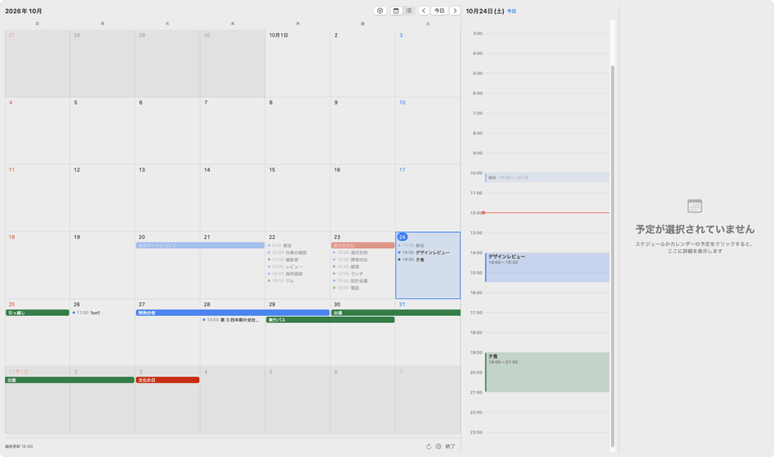
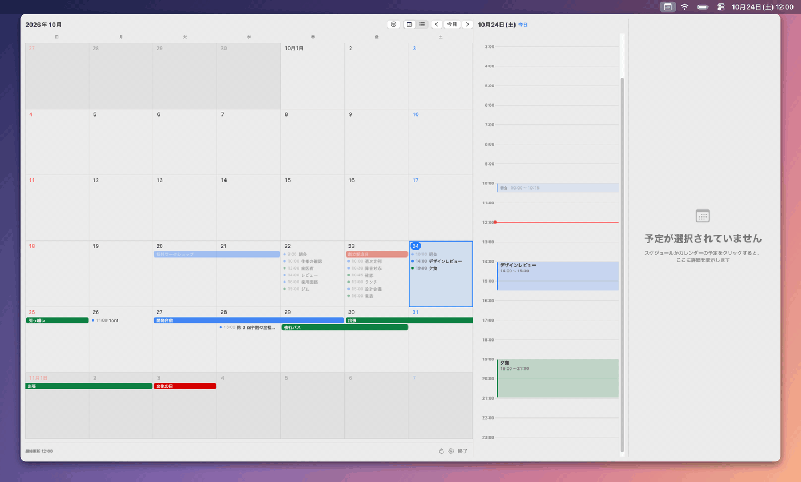
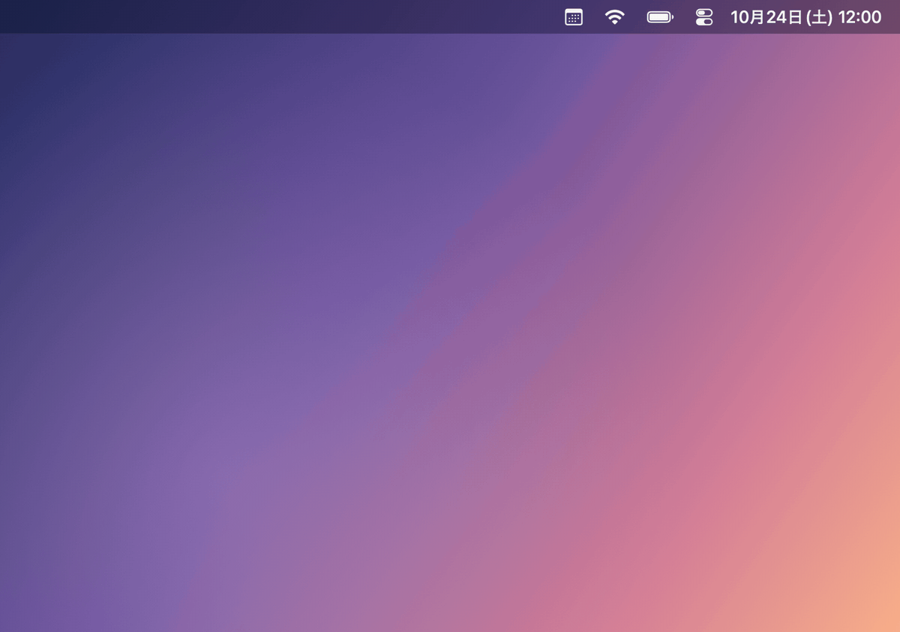
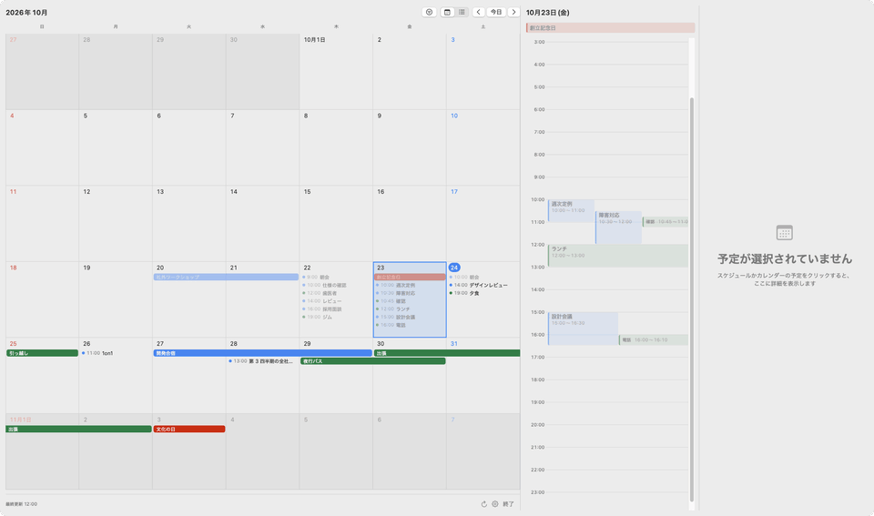
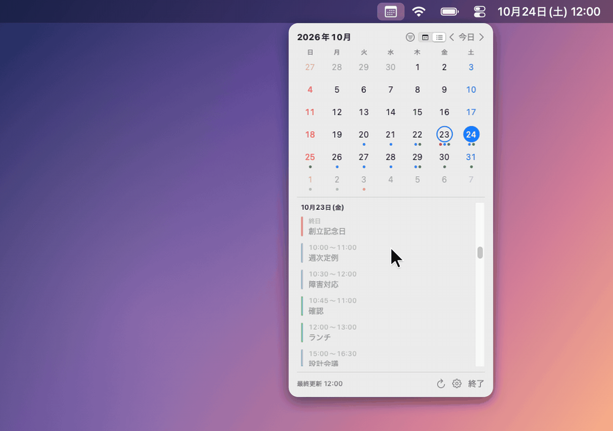

# Barlunari

メニューバーから、Google カレンダーなどの予定をすぐに確認できる macOS アプリです。予定は Mac のカレンダーから同期されます。macOS の「インターネットアカウント」に追加したアカウントのカレンダーを、Mac の「カレンダー」アプリと同じデータから EventKit で読み込み、まとめて表示します。アプリ自体にサインインはなく、認証情報も持ちません。


画像はすべて、架空のサンプルデータで作成しています。

## 特長

### 月表示

予定をマス目の中に並べた、大きな 1 枚のカレンダーです。日を押すと、右の欄にその日のスケジュールが時刻順に出ます。予定を押すと、さらに右の列に、場所・会議の URL・参加者・メモが出ます。スケジュールは出したままなので、同じ日の予定を続けて確認できます。



### 途切れずに流れるマス目

マス目は週の行が連続して流れ、スクロールすると表示月が切り替わります。月の境目で止まらないので、月をまたぐ予定も続けて確認できます。



### コンパクト表示

幅の狭い月のカレンダーと、日ごとの予定一覧です。予定一覧は選択日から始まり、スクロールすると日が進みます。



### 表示するカレンダーの切り替え

見出しのボタンから、表示するカレンダーをアカウントごとに選べます。チェックを切り替えると、その場で表示に反映されます。



### 設定

パネルの右下の歯車のボタンで、設定のウインドウを開きます。「一般」のタブでは、ログイン時に起動するかを選びます。「カレンダー」のタブでは、表示するカレンダーをアカウントごとにオンとオフで切り替えます。



## 必要環境

- macOS 15 以降
- Swift 6.2 以降のツールチェーン。Xcode 26 以降に含まれます

## インストール

```sh
git clone https://github.com/derushio/barlunari
cd barlunari
scripts/bundle.sh                  # Barlunari.app を組み立てます
open -g -j <Barlunari.app のパス>    # 前面に出さずに起動します
```

Claude Code を使っている場合は、次のように頼むと、クローンから起動までを Claude Code が実行します。

```text
https://github.com/derushio/barlunari をクローンして、Barlunari.app を組み立てて起動して
```

`scripts/bundle.sh` が作る `Barlunari.app` は ad-hoc 署名です。ビルドし直すと macOS が別のアプリとして扱い、カレンダーへのアクセスの許可をもう一度求めることがあります。その場合は、下の手順でもう一度許可します。

## 予定を表示する準備

Barlunari は macOS が同期したカレンダーを読むので、Google 側の設定は要りません。

### アカウントを追加する

1. macOS の「システム設定」を開き、「インターネットアカウント」を選びます
2. 「アカウントを追加」を押し、「Google」を選んで、画面の案内に従ってサインインします。複数のアカウントを追加できます
3. 追加したアカウントの「カレンダー」をオンにします

iCloud やその他の CalDAV のアカウントも、同じ手順で追加すると表示されます。アカウントの追加と削除は、Barlunari ではなく「インターネットアカウント」で行います。Barlunari の設定画面にも「「インターネットアカウント」を開く」ボタンがあります。

### カレンダーへのアクセスを許可する

1. メニューバーのカレンダーのアイコンをクリックします。アイコンを押したディスプレイのメニューバーの下に、パネルが開きます
2. 「カレンダーへのアクセスを許可」を押します
3. macOS のダイアログで、フルアクセスを許可します

許可を求めるのは、このボタンを押したときだけです。起動時には求めません。許可を拒否したときは、パネルに「システム設定を開く」が出ます。「プライバシーとセキュリティ」の「カレンダー」で、Barlunari にフルアクセスを許可します。

## 使い方

| 操作 | 方法 |
| --- | --- |
| パネルを開く | メニューバーのアイコンをクリック |
| パネルを閉じる | パネルの外をクリック、Esc キー、アイコンをもう一度クリック |
| 月表示に切り替える | パネルの上の切り替え、または ⌘1 |
| コンパクト表示に切り替える | パネルの上の切り替え、または ⌘2 |
| 詳細や一覧を閉じる | Esc キー |
| 設定を開く | パネルの右下の歯車のボタン |

- 選んだ表示モードは、次に開いたときも使われます
- 月表示のパネルは、開いたディスプレイの大きさに合わせて開きます。画面が狭いときは詳細の列を出さず、スケジュールの欄に詳細を開きます
- 入りきらない日の「他 N 件」を押すと、その日が選ばれ、全件がスケジュールの欄に出ます
- 予定に Google Meet、Zoom、Teams、Webex の URL があれば、予定から会議を開けます
- 複数のアカウントが同じ予定を持つときは、アカウントの並び順で先のアカウントの予定を 1 件だけ表示します。アカウントは名前の順です。祝日カレンダーや、複数のアカウントに招待された会議が、この場合に当たります
- 予定が出ないときは、「システム設定」の「インターネットアカウント」で、アカウントのカレンダーがオンになっているかを確かめます。予定の取得は、macOS がカレンダーを同期した結果に依存します

## 開発

```sh
swift build                                        # ビルド
swift test                                         # テスト。ヘッドレスで実行されます
swift run barlunari-snapshots .playwright/snapshots # 画面の見た目を PNG に出力します
```

テストとスナップショットは、画面にウインドウを表示せず、フォーカスも奪いません。設計は戦術的 DDD のレイヤードアーキテクチャで、外部ライブラリは使いません。開発の規則は [CLAUDE.md](CLAUDE.md) にあります。

Claude Code で開発する場合は、Claude Code が [CLAUDE.md](CLAUDE.md) を自動で読み込み、`.claude/skills/` のスキルを作業の内容に応じて読み込みます。レイヤーの依存の向きとヘッドレスのテストの規則は、この 2 か所に書いてあります。次のように頼みます。

```text
設定の「一般」のタブに、週の始まりの曜日を選ぶ項目を足して。テストを書いて、スナップショットで見た目を確かめて
```

## ライセンス

[MIT License](LICENSE)
